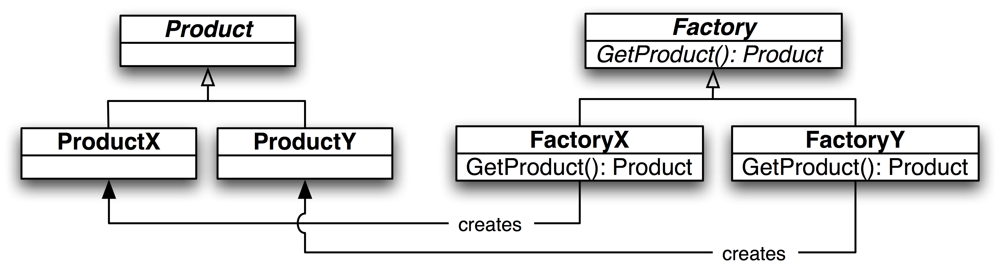
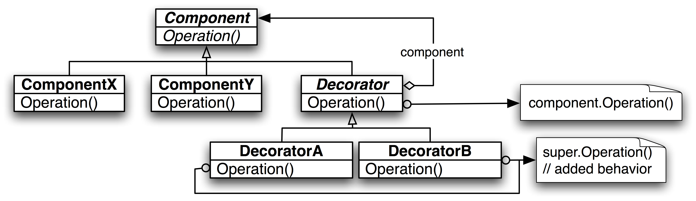
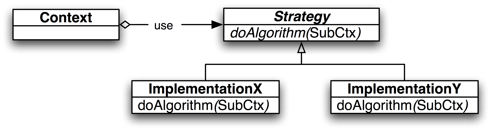
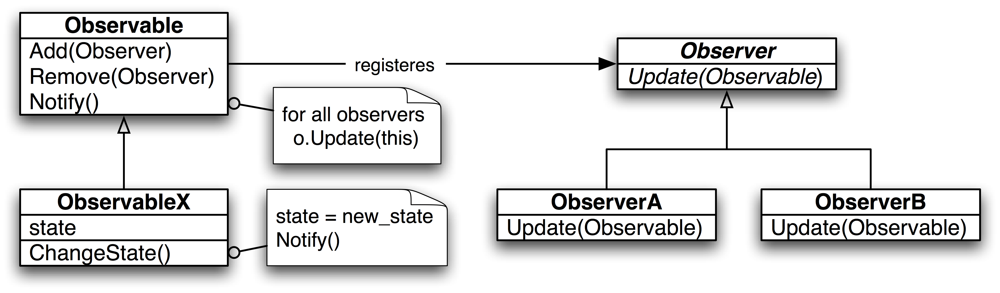

# _01_design_patterns

- Design patterns are reusable building blocks for solving common design problems.
- Types of patterns:
    - Creational - abstraction of instantiation process
    - Structural - composition of classes and objects in formation of larger structures
    - Behavioral - abstraction of algorithms and assignment of responsibility between objects

## Visualisation

- Creational - Factory Method
  

- Structural - Decorator
  

- Behavioral - Strategy
  

- Behavioral - Observer
  

## Helpful Links

- https://github.com/marknt15/java-tutorial/blob/3ceb46b201286d278477e0cd3838a082abf9a464/design-patterns.java
- https://github.com/dstar55/100-words-design-patterns-java
- https://github.com/ikite/ikite.github.io/wiki/Java-Design-Patterns